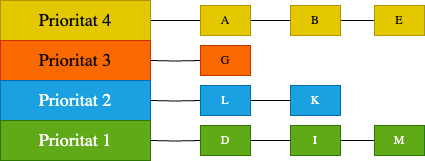
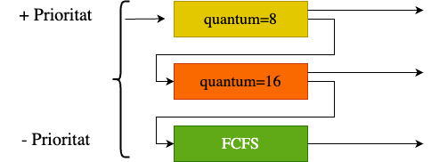

## Objectius de la sessió

::: {.objectius title="En acabar la sessió, has de ser capaç de"}
-   Planificar per **prioritats** i explicar la **inanició**, l'**envelliment** i la **inversió de prioritats**.
-   Aplicar **SJF** i **SRTF** i justificar en quines condicions són òptims.
-   Estimar la propera ràfega amb una **mitjana exponencial**.
-   Descriure com una **cua multinivell amb retroalimentació** aproxima SRTF sense conèixer el futur.
-   Relacionar-ho amb el planificador de **Linux** (Debian bookworm).
:::

::: {.prerequisits title="Necessites recordar"}
-   Mètriques: $T_{retorn}$, $T_{espera}$, $T_{resposta}$, $T_N$.
-   FCFS, RR, apropiació i efecte comboi.
:::

## On érem

-   FCFS i RR **no saben res** dels processos: tracten igual una tasca de 2 ms que una de 2 hores.
-   Avui afegim **informació**:
    -   una **importància** externa (prioritats);
    -   la **durada** de la propera ràfega (SJF i SRTF);
    -   el **comportament passat** (MLFQ).
-   Cada fragment d'informació millora alguna mètrica i obre un problema nou.

# Prioritats

## Planificació per prioritats

-   Cada procés té una **prioritat**; s'executa el preparat més prioritari.
-   En cas d'empat, s'aplica una altra política (habitualment FCFS o RR).
-   Pot ser **apropiativa** (un procés més prioritari expulsa l'actual) o **no apropiativa**.
-   Les prioritats poden ser **estàtiques** o **dinàmiques** (el SO les ajusta).

::: {.errorcomu title="Número petit, prioritat alta?" .fragment}
Depèn del sistema. A Linux, un `nice` **més baix** vol dir **més** prioritat, però en temps real una prioritat **més alta** (1–99) vol dir més prioritat. Sempre cal indicar quin conveni fa servir.
:::

## Exercici: prioritats

::: {.exercici title="Planificació per prioritats apropiativa"}
Número més petit = més prioritat (ordre B, A, C). Un procés que arriba amb més prioritat **expulsa** l'actual.

::: nonincremental
| Procés | $T_a$ | $T_{cpu}$ | Prioritat |
|--------|-------|-----------|-----------|
| A      | 0     | 7         | 5         |
| B      | 2     | 4         | 1         |
| C      | 3     | 2         | 6         |
:::

1.  Dibuixa el diagrama de Gantt.
2.  Calcula la utilització, la productivitat, $\bar{T}_{espera}$, $\bar{T}_{retorn}$ i $\bar{T}_{resposta}$.
:::

## Exercici 03: solució {.smaller}

::: {.solucio title="Prioritats apropiatives"}
::: nonincremental
| $t$ | 0 | 1 | 2 | 3 | 4 | 5 | 6 | 7 | 8 | 9 | 10 | 11 | 12 |
|-----|---|---|---|---|---|---|---|---|---|---|----|----|----|
| CPU | A | A | B | B | B | B | A | A | A | A | A  | C  | C  |

| Procés | $T_f$ | $T_{retorn}$ | $T_{espera}$ | $T_{resposta}$ | $T_N$ |
|--------|-------|--------------|--------------|----------------|-------|
| A      | 11    | 11           | 4            | 0              | 1.57  |
| B      | 6     | 4            | 0            | 0              | 1     |
| C      | 13    | 10           | 8            | 8              | 5     |
| **Mitjana** |  | **8.33**     | **4**        | **2.67**       | **2.52** |
:::

-   Utilització $= 13/13 = 100\%$; productivitat $= 3/13 \approx 0.23$ processos/u.t.
-   C és el més curt i el que pitjor surt: la prioritat ignora completament la durada.
:::

## Inanició i envelliment

::: {.definicio title="Inanició (starvation)"}
Un procés preparat no aconsegueix la CPU durant un temps **indefinit** perquè sempre n'hi ha de més prioritaris.
:::

-   **Envelliment** (*aging*): augmentar periòdicament la prioritat dels processos que fa temps que esperen.

:::{.fragment}
``` pseudocode
cada tick:
    per a cada procés p a la cua de preparats:
        si p.espera >= LLINDAR:
            p.prioritat = p.prioritat + 1   // més prioritari
            p.espera = 0
```
:::

-   Funciona, però és *ad hoc*: quin llindar? Quin increment? Si el sistema està saturat, tots acaben envellint i les prioritats deixen de voler dir res.


## Inversió de prioritats

:::{.definicio}
La **inversió de prioritats** (*priority inversion*) és un problema de planificació que apareix quan tasques amb prioritats diferents comparteixen recursos protegits mitjançant mecanismes de sincronització, com ara els *mutex*.
:::

Imaginem tres tasques:

- **H (High):** tasca d'alta prioritat. Necessita accedir a un recurs compartit.
- **M (Medium):** tasca de prioritat mitjana. No utilitza aquest recurs.
- **L (Low):** tasca de baixa prioritat. També necessita accedir al mateix recurs.

:::{.fragment}
H i L comparteixen un mutex, mentre que M no hi té cap relació. Considerem que les tres tasques competeixen per la CPU i que el planificador utilitza **prioritats preemptives**. Suposem aquestes necessitats de CPU:
:::

:::{.fragment}
| Tasca | Arriba a | CPU necessària | Notes |
|:-----:|:--------:|:--------------:|:------|
| L | t = 0 | 3 unitats | Les 3 dins la secció crítica |
| H | t = 2 | 3 unitats | Intenta agafar el mutex a t = 3 |
| M | t = 3 | 5 unitats | No utilitza el mutex |
:::

## Què passa durant l'execució?

```{mermaid}
gantt
    title Inversió de prioritats sense herència
    dateFormat X
    axisFormat %s

    section H (alta)
    Executa                 :h1, 2, 1
    Bloquejada pel mutex    :crit, h2, 3, 6
    Executa                 :h3, 9, 2

    section M (mitjana)
    Executa                 :m1, 3, 5

    section L (baixa)
    Executa amb el mutex    :l1, 0, 2
    Preemptada              :crit, l2, 2, 6
    Executa i allibera el mutex :l3, 8, 1
```

Seguim l'execució pas a pas:

- **Temps 0–2:** L comença a executar-se i adquireix el mutex per accedir al recurs compartit.
- **Temps 2–3:** arriba H, que té una prioritat superior, i desplaça L de la CPU. Quan intenta adquirir el mutex, comprova que està ocupat per L i queda **bloquejada**.
- **Temps 3–8:** a t = 3 arriba M, que està preparada per executar-se. Com que té més prioritat que L, el planificador li assigna la CPU. Encara que M no utilitza el recurs compartit, impedeix que L continuï executant-se.
- **Temps 8–9:** M acaba i L recupera la CPU. Acaba la seva secció crítica i allibera el mutex.
- **Temps 9–11:** H es desbloqueja, adquireix el mutex i continua executant-se.

## On és el problema?

Que H esperi L és **inevitable**: H necessita un recurs que L està fent servir, i aquesta espera queda acotada per la durada de la secció crítica de L. Això s'anomena **bloqueig acotat** i no és, per si mateix, un problema greu.

:::{.fragment .reflexio}
H, que és la tasca amb més prioritat, acaba esperant M, que té menys prioritat i ni tan sols utilitza el recurs compartit. Com que M pot executar-se tant de temps com vulgui (o tantes tasques de prioritat intermèdia com n'hi hagi), l'espera de H deixa de tenir un límit previsible.
:::

:::{.fragment}
La cadena de dependències és:

1. H necessita el mutex.
2. L té el mutex i és l'única que pot alliberar-lo.
3. M impedeix que L avanci perquè té més prioritat que L.

:::

:::{.fragment .reflexio}
La **inversió de prioritats** fa que un sistema de temps real incompleixi els seus terminis.
:::

## Com es pot solucionar?

Una solució habitual és el mecanisme d'**herència de prioritats** (*priority inheritance*). La idea és que, quan una tasca d'alta prioritat queda bloquejada esperant un recurs que té una tasca de baixa prioritat, aquesta última **hereta temporalment** la prioritat de la tasca bloquejada.

1. L té adquirit el mutex.
2. H intenta adquirir-lo i queda bloquejada.
3. El sistema detecta que L és qui impedeix que H continuï.
4. L hereta temporalment la prioritat d'H.
5. M ja no pot desplaçar L, perquè ara L té una prioritat superior.
6. L acaba la seva secció crítica i allibera el mutex.
7. L recupera la seva prioritat original i H es desbloqueja.

```{mermaid}
gantt
    title Execució amb herència de prioritats
    dateFormat X
    axisFormat %s

    section H (alta)
    Executa                 :h1, 2, 1
    Bloquejada pel mutex    :crit, h2, 3, 1
    Executa                 :h3, 4, 2

    section M (mitjana)
    Preparada (espera)      :m0, 3, 3
    Executa                 :m1, 6, 5

    section L (baixa)
    Executa amb el mutex    :l1, 0, 2
    Executa amb prioritat heretada :l2, 3, 1
```


## Un cas real: Mars Pathfinder (1997)

La inversió de prioritats no és només un problema teòric. Un cas molt conegut es va produir durant la missió **Mars Pathfinder** de la NASA, l'any 1997. El programari de vol s'executava sobre el sistema operatiu de temps real **VxWorks**, i les tasques implicades eren:

:::{.fragment}
- **Alta prioritat:** la gestió del bus d'informació.
- **Prioritat mitjana:** les tasques de comunicacions.
- **Baixa prioritat:** la recollida de dades meteorològiques, que feia servir un mutex compartit amb la tasca del bus.
:::

:::{.fragment}
Quan la tasca de baixa prioritat tenia el mutex, les tasques de prioritat intermèdia impedien que acabés la seva secció crítica. Com a conseqüència, la tasca del bus d'informació no podia complir els seus terminis i el *watchdog* del sistema provocava reinicis.
:::

:::{.fragment .solucio}
El problema es va solucionar activant l'**herència de prioritats** en el mutex, una modificació que es va poder aplicar remotament enviant el **fix/patch** des de la Terra.
:::

# SJF i SRTF

## I si coneguéssim el futur?

-   **SJF** (*Shortest Job First*): s'executa el preparat amb la **propera ràfega de CPU** més curta. **No apropiatiu**.
-   **SRTF** (*Shortest Remaining Time First*): versió **apropiativa**. Si arriba un procés amb una ràfega més curta que el que **queda** a l'actual, l'expulsa.

:::{.concepte .fragment}
Treure els curts del sistema com més aviat millor. Els curts en surten molt beneficiats i els llargs, gairebé gens perjudicats.
:::

::: {.errorcomu title="Noms que canvien segons el llibre" .fragment}
La bibliografia anomena **STCF** (*Shortest Time-to-Completion First*) la versió **apropiativa**; altres textos usen STCF per a SJF. Aquí només usarem **SJF** (no apropiatiu) i **SRTF** (apropiatiu).
:::

## SJF: exemple

::::: columns
::: {.column width="35%"}
::: nonincremental
| $p$   | $T_a$ | $T_{cpu}$ |
|:-----:|:-----:|:---------:|
| 🟢 P1 | 0     | 10        |
| 🔵 P2 | 0     | 5         |
| 🟣 P3 | 1     | 4         |
:::
:::

::: {.column width="65%"}
```{mermaid}
%%| echo: false
gantt
    title SJF (no apropiatiu)
    dateFormat X
    axisFormat %s

    section Execució
    🔵 P2 : 0, 5
    🟣 P3 : 5, 9
    🟢 P1 : 9, 19
    section Preparats
    🟢 P1 a la cua : 0, 9
    🟣 P3 a la cua : 1, 5
```

::: nonincremental
| Mètrica        | P1 | P2 | P3 | Mitjana |
|----------------|----|----|----|---------|
| $T_{espera}$   | 9  | 0  | 4  | 4.33    |
| $T_{retorn}$   | 19 | 5  | 8  | 10.67   |
| $T_{resposta}$ | 9  | 0  | 4  | 4.33    |
:::
:::
:::::

::: notes
A t=0 P2 (5) és més curt que P1 (10). A t=1 arriba P3 (4), però SJF no és apropiatiu i P2 continua fins a t=5. Bona pregunta per a classe: amb SRTF, P3 expulsaria P2? A t=1 a P2 li queden exactament 4 unitats: és un empat, i el resultat depèn del conveni de desempat.
:::

## SRTF: exemple

::::: columns
::: {.column width="35%"}
::: nonincremental
| $p$   | $T_a$ | $T_{cpu}$ |
|:-----:|:-----:|:---------:|
| 🟢 P1 | 0     | 20        |
| 🔵 P2 | 5     | 5         |
| 🟣 P3 | 8     | 1         |
:::
:::

::: {.column width="65%"}
```{mermaid}
%%| echo: false
gantt
    title SRTF (apropiatiu)
    dateFormat X
    axisFormat %s

    section Execució
    🟢 P1 : 0, 5
    🔵 P2 : 5, 8
    🟣 P3 : 8, 9
    🔵 P2 : 9, 11
    🟢 P1 : 11, 26
    section Preparats
    🟢 P1 a la cua : 5, 11
    🔵 P2 a la cua : 8, 9
```

::: nonincremental
| Mètrica        | P1 | P2 | P3 | Mitjana |
|----------------|----|----|----|---------|
| $T_{espera}$   | 6  | 1  | 0  | 2.33    |
| $T_{retorn}$   | 26 | 6  | 1  | 11      |
| $T_{resposta}$ | 0  | 0  | 0  | 0       |
:::
:::
:::::

::: notes
A t=5, a P1 li queden 15 i P2 en necessita 5: expulsió. A t=8, a P2 li queden 2 i P3 en necessita 1: expulsió. Comproveu sempre que l'últim instant del Gantt sigui la suma de totes les ràfegues (20+5+1 = 26) si la CPU no ha estat mai ociosa.
:::

## Per què SRTF és la referència?

::: {.concepte title="Optimalitat"}
Si tots els processos arriben alhora, **SJF** minimitza $\bar{T}_{espera}$ i $\bar{T}_{retorn}$ entre les polítiques no apropiatives. Amb arribades arbitràries, **SRTF** ho fa entre totes les polítiques.
:::

-   Intuïció: avançar un procés curt davant d'un de llarg redueix l'espera del curt més del que augmenta la del llarg.
-   Optimalitat **sota supòsits**: durades conegudes, canvi de context gratuït i una sola CPU.
-   Com que és òptim, s'usa de **vara de mesurar**: com de lluny queda una política real de SRTF?

::: {.errorcomu title="Òptim per al retorn, no per a la resposta" .fragment}
SRTF optimitza $\bar{T}_{retorn}$ i $\bar{T}_{espera}$. Per a $T_{resposta}$ (primera execució), RR amb un quantum petit pot ser millor.
:::

## Un exemple que ho explica tot {.smaller}

-   **A** i **B**: limitats per CPU, s'executen durant setmanes.
-   **C**: limitat per E/S, en bucle: 1 ms de CPU i 9 ms de disc.
-   Sol, C manté el disc ocupat un 90 % del temps.

::: {.nonincremental .fragment}
| Política        | Què passa                                           | Utilització del disc |
|-----------------|-----------------------------------------------------|----------------------|
| FCFS            | Si entra A o B, té la CPU durant setmanes            | ≈ 0 %                |
| RR, $q = 100\,ms$ | C fa 1 ms i espera A i B: 9 ms de disc cada 201 ms | ≈ 4.5 %              |
| RR, $q = 1\,ms$ | C torna a temps, però amb molts canvis de context   | ≈ 90 %               |
| SRTF            | C sempre té la ràfega més curta i expulsa A o B     | ≈ 90 %               |
:::

::: {.reflexio .fragment}
Donar prioritat a les ràfegues curtes no només beneficia C: manté **ocupats** els dispositius, i A i B gairebé no ho noten.
:::

::: notes
Exemple de Kubiatowicz, CS162 Lec 11. Amb RR de 100 ms: C fa 1 ms de CPU, llança l'E/S de 9 ms, però no torna a tenir la CPU fins que A i B han consumit 100 ms cadascun: 9/201 ≈ 4.5 %.
:::

## El problema: ningú coneix el futur

-   Alguns sistemes per lots demanen a l'usuari una **estimació** de durada i maten la tasca si la supera.
-   Fins i tot un usuari honest ho té molt difícil per a cada ràfega.
-   SRTF també és **injust**: si arriben curts constantment, els llargs pateixen **inanició**.

::: {.concepte title="Predir a partir del passat" .fragment}
Els programes tenen un comportament força estable: si les últimes ràfegues han estat curtes, la propera probablement també ho serà.
:::

# Predir la propera ràfega

## Mitjana exponencial

Siguin $t_n$ la durada **real** de la ràfega $n$ i $\tau_n$ la seva **predicció**:

$$\tau_{n+1} = \alpha\, t_n + (1-\alpha)\,\tau_n, \qquad 0 \leq \alpha \leq 1$$

-   $\alpha = 0$: ignorem el present, $\tau$ no canvia mai.
-   $\alpha = 1$: només compta l'última ràfega.
-   En desplegar-la: $\tau_{n+1} = \alpha t_n + (1-\alpha)\alpha t_{n-1} + (1-\alpha)^2 \alpha t_{n-2} + \dots$ El passat pesa **exponencialment** menys.

## Mitjana exponencial: exemple

::: {.exemple title="α = 1/2, τ₀ = 10"}
::: nonincremental
| $n$                       | 0  | 1 | 2 | 3 | 4 | 5  | 6  | 7  |
|---------------------------|----|---|---|---|---|----|----|----|
| Ràfega real $t_n$         | 6  | 4 | 6 | 4 | 13 | 13 | 13 | –  |
| Predicció $\tau_n$        | 10 | 8 | 6 | 6 | 5 | 9  | 11 | 12 |
:::
:::

-   La predicció **segueix** el canvi de comportament (de ≈5 a 13) amb uns quants passos de retard.
-   Amb $\alpha$ gran segueix més de pressa, però també és més sensible a una ràfega anòmala.

::: notes
τ1 = 0.5·6 + 0.5·10 = 8; τ2 = 0.5·4 + 0.5·8 = 6; τ3 = 6; τ4 = 5; τ5 = 0.5·13 + 0.5·5 = 9; τ6 = 11; τ7 = 12. Exemple clàssic de Silberschatz. SRTF amb predicció és una política implementable; la predicció és tan bona com estable sigui el programa.
:::

## Exercici 04: SJF vs RR {.smaller}

::: {.exercici title="Ràfegues de CPU i d'E/S"}
Planifica amb **RR ($q = 3$)** i amb **SJF no apropiatiu** (segons la **propera ràfega** de CPU).

::: nonincremental
| Procés | $T_a$ | Ràfegues                                   |
|--------|-------|--------------------------------------------|
| A      | 7     | $5_{CPU},\ 2_{E/S},\ 4_{CPU}$              |
| B      | 3     | $4_{CPU},\ 1_{E/S},\ 1_{CPU},\ 1_{E/S},\ 1_{CPU}$ |
| C      | 1     | $2_{CPU},\ 1_{E/S},\ 3_{CPU},\ 2_{E/S},\ 1_{CPU}$ |
:::

-   Convenis: cada procés té el seu dispositiu (les E/S no fan cua). Si diversos processos entren alhora a la cua de preparats, l'ordre és **B, A, C**, i a RR els que arriben o tornen d'E/S entren **abans** que l'expulsat en aquell instant.
-   Calcula $\bar{T}_{espera}$ (temps a la cua de preparats), $\bar{T}_{resposta}$ i $\bar{T}_{retorn}$, i compara les dues polítiques.
:::

## Exercici 04: solució {.smaller}

::: {.solucio title="RR (q = 3) i SJF no apropiatiu"}
::: nonincremental
| $t$ | 0 | 1 | 2 | 3 | 4 | 5 | 6 | 7 | 8 | 9 | 10 | 11 | 12 | 13 | 14 | 15 | 16 | 17 | 18 | 19 | 20 | 21 | 22 |
|-----|---|---|---|---|---|---|---|---|---|---|----|----|----|----|----|----|----|----|----|----|----|----|----|
| RR  | – | C | C | B | B | B | C | C | C | B | A  | A  | A  | B  | C  | A  | A  | B  | –  | A  | A  | A  | A  |
| SJF | – | C | C | B | B | B | B | C | C | C | B  | A  | A  | A  | A  | A  | B  | C  | A  | A  | A  | A  |    |

| Política | $T_{retorn}$ (A, B, C) | $T_{espera}$ (A, B, C) | $T_{resposta}$ (A, B, C) | $\bar{T}_{retorn}$ | $\bar{T}_{espera}$ | $\bar{T}_{resposta}$ |
|----------|------------------------|------------------------|--------------------------|--------------------|--------------------|----------------------|
| RR       | 16, 15, 14             | 5, 7, 5                | 3, 0, 0                  | 15                 | 5.67               | 1                    |
| SJF      | 15, 14, 17             | 4, 6, 8                | 4, 0, 0                  | 15.33              | 6                  | 1.33                 |
:::

-   Aquí **RR guanya SJF** en les tres mitjanes. A $t=11$, SJF dona la CPU a la ràfega de 5 d'A i, a $t=12$, B i C tornen d'E/S amb ràfegues d'1 unitat i s'han d'esperar: **comboi**.
-   SJF no apropiatiu és òptim només si tots arriben alhora; amb E/S i arribades escalonades, no hi ha garantia.
:::

::: notes
Solució calculada per simulació amb els convenis de l'enunciat. L'únic empat real és a t=11, quan B i C tornen d'E/S alhora: l'ordre B, A, C posa B davant. A SJF hi ha un altre empat a t=16 (B i C, ràfega 1): també guanya B. Exigiu sempre que els estudiants escriguin el conveni. Les solucions en PDF d'anys anteriors poden diferir si usaven altres convenis.
:::

# Cues multinivell

## Cues multinivell

Separar els processos en diverses cues, cadascuna amb la seva política.

::::: columns
::: {.column width="50%"}
{width="90%"}

**Sense retroalimentació**: cada procés queda **fix** en una cua segons el seu tipus (p. ex. interactius en primer pla amb RR, lots en segon pla amb FCFS).
:::

::: {.column width="50%"}
{width="90%"}

**Amb retroalimentació (MLFQ)**: un procés **canvia de cua** segons com es comporta.
:::
:::::

-   Entre cues: **prioritat estricta** (no se serveix una cua fins que les superiors són buides) o **repartiment** (p. ex. 70 % / 20 % / 10 %).

## MLFQ: les regles bàsiques

::: nonincremental
1.  Si $\text{prioritat}(A) > \text{prioritat}(B)$, s'executa A.
2.  Si tenen la mateixa prioritat, RR entre ells.
3.  Un procés nou entra a la cua **més alta**.
4.  Si **esgota el quantum**, baixa un nivell.
5.  Si **deixa la CPU abans** (es bloqueja per E/S), es queda al mateix nivell (o puja).
:::

-   Els quantums **creixen** cap avall (p. ex. 8, 16, FCFS; o 1, 2, 4 ms): als nivells baixos hi ha processos llargs i convé canviar-los poc.
-   Resultat: els limitats per CPU **cauen com una pedra** i els interactius es queden a dalt. **Aproxima SRTF** sense conèixer el futur: la durada es descobreix executant.

::: notes
L'MLFQ es remunta a CTSS (Corbató, 1962). Fixeu-vos que la regla 5 depèn de si el procés es bloqueja abans d'esgotar el quantum, no de si acaba el procés sencer.
:::

## MLFQ: dos problemes

::: {.errorcomu title="1. Inanició"}
Si hi ha prou interactius, els processos dels nivells baixos no s'executen mai.

**Solució**: cada cert temps $S$, **tots els processos tornen a la cua més alta** (*priority boost*). Això també recupera un procés que ha passat de càlcul a interactiu.
:::

::: {.errorcomu title="2. Fer trampa (gaming)" .fragment}
Un procés pot fer una E/S inútil just abans d'esgotar el quantum i quedar-se sempre a dalt.

**Solució**: comptabilitzar el temps **acumulat** a cada nivell; quan s'esgota el pressupost, baixa, encara que l'hagi gastat en molts trossos.
:::

## Exemple real: l'Othello

-   Un concurs de programes d'Othello en un sistema amb MLFQ.
-   Un equip va afegir `printf()` sense cap funció al bucle de càlcul.
-   Cada `printf()` era una E/S: el sistema el classificava com a **interactiu**, el mantenia a les cues altes i el seu programa **pensava més ràpid** que el dels rivals.

::: {.reflexio title="I si tothom ho fes?" .fragment}
Si tots els processos fan trampa, tots són a dalt i l'MLFQ torna a ser un RR... amb molta E/S inútil. Qualsevol heurística basada en el comportament es pot manipular; per això cal la comptabilitat de temps acumulat.
:::

# Linux

## El planificador de Debian bookworm

Debian bookworm usa el kernel **6.1**, amb **CFS** (*Completely Fair Scheduler*) per als processos normals.

-   **`SCHED_OTHER`** (CFS): reparteix la CPU en proporció a un **pes** derivat del `nice` ($-20$ … $19$). Cada nivell de `nice` són ≈ 10 % de CPU respecte d'un veí. Tria sempre el procés amb menys temps de CPU **virtual** consumit.
-   **`SCHED_FIFO`** i **`SCHED_RR`**: classes de **temps real** amb prioritat estricta 1–99 que sempre expulsen `SCHED_OTHER`. `SCHED_RR` usa un quantum (per defecte 100 ms).
-   Des del kernel 6.6, CFS s'ha substituït per **EEVDF**, que manté la idea de repartiment per pesos.

::: {.concepte title="nice no és una prioritat estricta" .fragment}
Amb CFS, un procés amb `nice` 19 **també** s'executa: rep menys CPU, però no pateix inanició.
:::

## Resum

::: {.resum}
-   **Prioritats**: control explícit de la importància. Problemes: **inanició** (envelliment) i **inversió de prioritats** (herència de prioritat).
-   **SJF/SRTF**: òptims per a $\bar{T}_{retorn}$ i $\bar{T}_{espera}$ amb durades conegudes. A la pràctica, **injustos** i **impossibles** sense predir.
-   **Mitjana exponencial**: predicció barata de la propera ràfega.
-   **MLFQ**: aproxima SRTF observant el comportament. Necessita **boost** contra la inanició i **comptabilitat acumulada** contra les trampes.
-   **Linux**: CFS reparteix per pesos (`nice`); les classes de temps real tenen prioritat estricta.
:::

::: {.lectures title="Per aprofundir"}
-   `man 7 sched`.
:::
